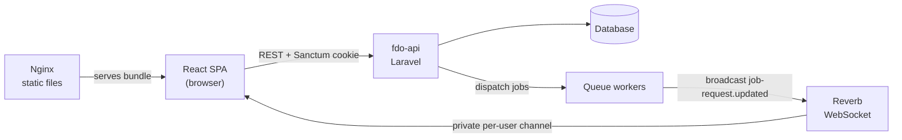

# FDO — Financial Data Overview

**English** · [Português](README.pt-br.md)

A personal finance dashboard that imports bank statements, auto-categorizes transactions with user-defined rules, and visualizes spending and income over time.

This repository contains the web client: a React + TypeScript single-page application. The REST API, queue workers and WebSocket server live in [fdo-api](https://github.com/AntonioHenriqueGF/fdo-api) (Laravel).

## Quick links

- **Live demo:** https://api.antoniodev.net/login
- **API repository:** [AntonioHenriqueGF/fdo-api](https://github.com/AntonioHenriqueGF/fdo-api)
- **Demo account:** <!-- TODO(author): add demo credentials (e.g. email / password of a read-only seeded user) --> _coming soon_

## Screenshots

<!-- TODO(author): record a short GIF (CSV import → dashboard) and/or 2–3 screenshots, save them under docs/screenshots/ and uncomment the lines below.


-->

_Screenshots coming soon. In the meantime, try the [live demo](https://api.antoniodev.net/login)._

## Features

**Authentication**
- Login and registration with Laravel Sanctum cookie-based sessions
- Route loaders that keep guests out of the dashboard and send signed-in users to it

**Statement import (CSV)**
- Client-side CSV parsing with a preview of the raw rows
- Automatic header-row detection that the user can override
- Per-column type mapping: three date formats (`MM/DD/YYYY`, `DD/MM/YYYY`, `YYYY-MM-DD`), description, single signed amount, separate credit/debit columns, closing balance, or ignore
- History of previous imports, with deletion

**Categories and rules**
- Category CRUD, with a flag that marks a category as income
- Rules per category (text pattern + priority) that classify transactions automatically
- One-click reprocessing that re-applies every rule to existing transactions

**Transactions and daily balances**
- Full CRUD for both
- Server-side pagination
- Filters by date range, plus by category for transactions

**Dashboard**
- Monthly or daily granularity, with period presets (1M, 3M, 6M, 1Y, 2Y, ALL) and a multi-select category filter
- Closing balance (line chart), net transactions per period, categories per period (income above zero, expenses below) and totals by category (bar charts), built with MUI X Charts

**Real-time job notifications**
- Imports and rule reprocessing run as background jobs; the UI shows toasts when a job starts, completes or fails

## Technical highlights

**CSV import pipeline.** Every bank exports statements differently, so the importer does not assume a fixed layout. The file is parsed in the browser with `react-papaparse`. A heuristic picks the header row (the first fully populated row among the first 30), and the user can correct it and assign a type to each column. Before upload, rows are normalized: dates are rewritten as ISO `YYYY-MM-DD`, and amounts in either `3.000,00` or `3,000.00` style are parsed by treating the last separator as the decimal point. Validation ensures a date, a description and at least one amount column are mapped. The API receives clean, uniform data whatever the source format.

**Real-time job feedback that survives reloads.** Heavy work (import processing, rule reprocessing) runs on backend queues. The SPA subscribes to a private per-user channel (`App.Models.User.{id}`) through Laravel Echo and Reverb, and listens for `job-request.updated` events. Channel authorization reuses the same Axios instance, so it goes through the Sanctum session. IDs of active jobs are persisted in `localStorage`; on the next load they are re-fetched from `/api/job-requests/{id}`. A job that finished while the tab was closed still produces its "completed" or "failed" toast.

**Cookie-based SPA authentication.** The app uses Sanctum's SPA flow instead of tokens in JavaScript-accessible storage. It requests `/sanctum/csrf-cookie` before login or registration, and a single Axios instance sends every request with `withCredentials` and `withXSRFToken`. Access control lives in React Router loaders (`requireAuthLoader` / `requireGuestLoader`) that call `/api/me` before a route renders. This avoids protected screens flashing before a redirect.

**Lightweight, scoped state with Jotai.** State that crosses component boundaries is held in small Jotai atoms grouped by feature: the import wizard's steps, the dashboard filters and drawer, and the job registry. Derived atoms (e.g. `activeJobsAtom`) compute views of the job registry, and the dashboard filters atom keeps the selected period and granularity while the user navigates between pages. Server data stays in the components that fetch it, so there is no global store to keep in sync.

## Architecture



In production the SPA is built into static files and served by an Nginx container. Everything else runs in the [fdo-api](https://github.com/AntonioHenriqueGF/fdo-api) stack. The containers share the external Docker network `fdo_network`.

## Tech stack

| Layer | Technology | Purpose |
| --- | --- | --- |
| Language | TypeScript 6.0 | Static typing across the codebase |
| UI | React 19.2 | Component model and rendering |
| Build | Vite 8 | Dev server and production bundling |
| Routing | React Router 7.14 | Data router with auth loaders |
| Components | Material UI (MUI) 9, Base UI 1.4 | UI components and theming |
| Data display | MUI X Data Grid 9.9, MUI X Charts 9.6 | Paginated tables and dashboard charts |
| Styling | styled-components 6, Emotion 11 | Component-scoped styles |
| State | Jotai 2.19 | Feature-scoped atoms |
| HTTP | Axios 1.17 | API client with credentials and XSRF |
| Real time | Laravel Echo 2.3, pusher-js 8.5 | Reverb WebSocket subscription |
| CSV | react-papaparse 4.4, PapaParse 5.5 | In-browser CSV parsing |
| Dates | date-fns 4.4 | Period presets and date formatting |
| Feedback | notistack 3 | Toast notifications |
| Tooling | ESLint 9, Prettier 3 | Linting and formatting |
| Delivery | Docker, Nginx, Certbot | Static hosting and TLS certificates |

## Getting started

### Prerequisites

- Node.js 24 (the Docker images use `node:24.14.1`) and npm
- A running instance of [fdo-api](https://github.com/AntonioHenriqueGF/fdo-api), including its Reverb server
- Docker and Docker Compose (only for the container workflows)

> **The frontend needs the API.** Without fdo-api running, the app can't log in or load data. Follow the setup in the [fdo-api repository](https://github.com/AntonioHenriqueGF/fdo-api) first.

### Environment variables

Copy `example.env` to `.env` and fill in the values. Vite inlines them at build time, so rebuild after changing them.

| Name | Description | Example |
| --- | --- | --- |
| `VITE_BACKEND_URL` | Base URL of fdo-api (REST, Sanctum and broadcasting auth) | `http://localhost:8000` |
| `VITE_REVERB_APP_KEY` | Reverb application key (matches the API's `REVERB_APP_KEY`) | `your-reverb-app-key` |
| `VITE_REVERB_HOST` | Host of the Reverb WebSocket server | `localhost` |
| `VITE_REVERB_PORT` | Port of the Reverb WebSocket server | `8080` |
| `VITE_REVERB_SCHEME` | `https` forces TLS (`wss`); anything else uses `ws` | `http` |

### Local development (Node)

```bash
npm install
cp example.env .env   # then edit the values
npm run dev
```

Vite prints the local URL (by default http://localhost:5173). Other scripts:

```bash
npm run build     # type-check and build to dist/
npm run preview   # serve the production build locally
npm run lint      # ESLint
npm run format    # Prettier
```

### Development with Docker

The compose files attach to an external network shared with the fdo-api stack. Create it once:

```bash
docker network create fdo_network
```

Then start the dev container. `docker-compose.override.yml` is applied automatically; it uses `Dockerfile.dev` and runs the Vite dev server (`npm start`, port 81):

```bash
docker compose up -d --build
```

### Production (static build + Nginx + Certbot)

`Dockerfile` is a multi-stage build: Node compiles the app, then `nginx:alpine` serves `dist/` using `nginx/conf.d/default.conf`. That config adds an SPA fallback to `index.html` and the `X-Content-Type-Options` and `X-Frame-Options` headers.

```bash
docker compose -f docker-compose.yml -f docker-compose.prod.yml up -d --build
```

TLS is handled by Certbot (defined in `docker-compose.prod.yml`) using the HTTP-01 webroot challenge. The public-facing Nginx must serve `./certbot/www` at `/.well-known/acme-challenge/` (see `nginx/conf.d/prod.conf.gen-cert` and `nginx/templates/prod.conf.template`). Then issue a certificate:

```bash
mkdir -p certbot/www/.well-known/acme-challenge

docker compose \
  -f docker-compose.yml \
  -f docker-compose.prod.yml \
  run --rm certbot certonly \
  --webroot \
  --webroot-path=/var/www/certbot \
  -d your-domain.com \
  --email you@example.com \
  --agree-tos \
  --no-eff-email
```

To renew automatically, add a cron entry on the server. Replace `/path` with the project's absolute path and `nginx` with the service name of your public-facing Nginx:

```bash
0 6 * * * docker compose -f /path/docker-compose.yml -f /path/docker-compose.prod.yml run --rm certbot renew && docker compose -f /path/docker-compose.yml -f /path/docker-compose.prod.yml exec nginx nginx -s reload
```

## Project structure

```text
src/
├── main.tsx, App.tsx     # Entry point; theme, toast and router providers
├── MuiStyleProvider.tsx  # MUI theme (palette, typography, overrides)
├── routes/               # Router definition and auth loaders (/api/me)
├── Services/             # Axios instance, request helper, Laravel Echo client
├── modules/              # Feature modules (views, components, atoms, routes)
│   ├── Login/            # Login, registration and public project showcase
│   ├── AuthGuard/        # Layout for authenticated routes
│   ├── UnauthGuard/      # Layout for guest-only routes
│   ├── GlobalGuard/      # Root layout
│   ├── Dashboard/        # Shell (sidebar, drawer), charts, filters
│   ├── FileImport/       # CSV reader, column mapping, normalization, import list
│   ├── Categories/       # Categories, rules and rule reprocessing
│   ├── Transactions/     # Transaction grid, filters and form
│   ├── DailyBalances/    # Daily balance grid, filters and form
│   ├── JobNotifications/ # Echo provider, job store and toasts
│   └── ErrorBoundaries/  # Global error boundary
├── shared/               # Reusable components and interfaces
├── styles/               # Global CSS and self-hosted fonts (Inter, Montserrat)
├── utils/                # Small helpers
└── assets/               # Logo and images
```

### Routes

| Path | Access | Screen |
| --- | --- | --- |
| `/login` | Guest | Login |
| `/signin` | Guest | Registration |
| `/dashboard` | Authenticated | Dashboard charts |
| `/dashboard/statement-import` | Authenticated | CSV import |
| `/dashboard/categories` | Authenticated | Categories and rules |
| `/dashboard/transactions` | Authenticated | Transactions |
| `/dashboard/daily-balances` | Authenticated | Daily balances |

## Roadmap

- **XLSX import:** accept Excel statements in addition to CSV
- **Automated tests:** unit and component tests with Vitest + Testing Library

## Related repositories

- [fdo-api](https://github.com/AntonioHenriqueGF/fdo-api): Laravel REST API, queue workers and Reverb broadcasting

## Author

**Antonio Henrique Fournier** <!-- TODO(author): confirm full name as it should appear publicly -->

- LinkedIn: [antonio-fournier](https://www.linkedin.com/in/antonio-fournier/)
- GitHub: [AntonioHenriqueGF](https://github.com/AntonioHenriqueGF)
