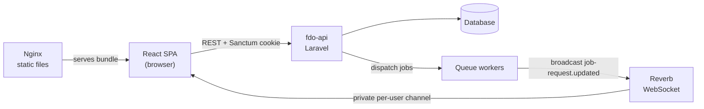

# FDO — Financial Data Overview

[English](README.md) · **Português**

Um painel de finanças pessoais que importa extratos bancários, categoriza transações automaticamente com regras definidas pelo usuário e mostra a evolução de gastos e receitas ao longo do tempo.

Este repositório contém o cliente web: uma aplicação single-page em React + TypeScript. A API REST, os workers de fila e o servidor WebSocket ficam no [fdo-api](https://github.com/AntonioHenriqueGF/fdo-api) (Laravel).

## Links rápidos

- **Demo online:** https://api.antoniodev.net/login
- **Repositório da API:** [AntonioHenriqueGF/fdo-api](https://github.com/AntonioHenriqueGF/fdo-api)
- **Conta de demonstração:** <!-- TODO(author): adicionar credenciais de demo (ex.: e-mail / senha de um usuário somente leitura com dados de exemplo) --> _em breve_

## Capturas de tela

<!-- TODO(author): gravar um GIF curto (importação de CSV → dashboard) e/ou 2–3 capturas, salvar em docs/screenshots/ e descomentar as linhas abaixo.


-->

_Capturas de tela em breve. Enquanto isso, experimente a [demo online](https://api.antoniodev.net/login)._

## Funcionalidades

**Autenticação**
- Login e cadastro com sessões baseadas em cookie do Laravel Sanctum
- Loaders de rota que mantêm visitantes fora do dashboard e levam usuários autenticados até ele

**Importação de extratos (CSV)**
- Leitura do CSV no navegador, com prévia das linhas brutas
- Detecção automática da linha de cabeçalho, que o usuário pode corrigir
- Mapeamento de tipo por coluna: três formatos de data (`MM/DD/YYYY`, `DD/MM/YYYY`, `YYYY-MM-DD`), descrição, valor único com sinal, colunas separadas de crédito/débito, saldo final ou ignorar
- Histórico das importações anteriores, com exclusão

**Categorias e regras**
- CRUD de categorias, com uma opção que marca a categoria como receita
- Regras por categoria (padrão de texto + prioridade) que classificam as transações automaticamente
- Reprocessamento com um clique, que reaplica todas as regras às transações existentes

**Transações e saldos diários**
- CRUD completo para ambos
- Paginação no servidor
- Filtros por intervalo de datas e, nas transações, também por categoria

**Dashboard**
- Granularidade mensal ou diária, com períodos predefinidos (1M, 3M, 6M, 1Y, 2Y, ALL) e filtro de múltiplas categorias
- Saldo final (gráfico de linha), transações líquidas por período, categorias por período (receitas acima de zero, despesas abaixo) e totais por categoria (gráficos de barras), feitos com MUI X Charts

**Notificações de jobs em tempo real**
- Importações e reprocessamento de regras rodam como jobs em segundo plano; a interface mostra toasts quando um job inicia, conclui ou falha

## Destaques técnicos

**Pipeline de importação de CSV.** Cada banco exporta extratos de um jeito, então o importador não assume um layout fixo. O arquivo é lido no navegador com `react-papaparse`. Uma heurística escolhe a linha de cabeçalho (a primeira linha totalmente preenchida entre as 30 primeiras), e o usuário pode corrigi-la e atribuir um tipo a cada coluna. Antes do envio, as linhas são normalizadas: as datas são reescritas no formato ISO `YYYY-MM-DD`, e valores no estilo `3.000,00` ou `3,000.00` são interpretados tratando o último separador como decimal. A validação garante que uma data, uma descrição e pelo menos uma coluna de valor estejam mapeadas. A API recebe dados limpos e uniformes, seja qual for o formato de origem.

**Feedback de jobs em tempo real que sobrevive a recarregamentos.** O trabalho pesado (processamento de importações e reprocessamento de regras) roda em filas no backend. A SPA se inscreve em um canal privado por usuário (`App.Models.User.{id}`) via Laravel Echo e Reverb e escuta eventos `job-request.updated`. A autorização do canal reutiliza a mesma instância do Axios, então passa pela sessão do Sanctum. Os IDs dos jobs ativos ficam salvos no `localStorage`; no carregamento seguinte, eles são consultados de novo em `/api/job-requests/{id}`. Um job que terminou com a aba fechada ainda gera o toast de "concluído" ou "falhou".

**Autenticação de SPA baseada em cookie.** O app usa o fluxo de SPA do Sanctum em vez de tokens em armazenamento acessível por JavaScript. Ele chama `/sanctum/csrf-cookie` antes do login ou do cadastro, e uma única instância do Axios envia todas as requisições com `withCredentials` e `withXSRFToken`. O controle de acesso fica em loaders do React Router (`requireAuthLoader` / `requireGuestLoader`), que consultam `/api/me` antes de a rota renderizar. Assim, telas protegidas não aparecem por um instante antes do redirecionamento.

**Estado leve e com escopo definido usando Jotai.** O estado compartilhado entre componentes fica em átomos pequenos do Jotai, agrupados por funcionalidade: as etapas do assistente de importação, os filtros e o menu lateral do dashboard e o registro de jobs. Átomos derivados (ex.: `activeJobsAtom`) calculam visões do registro de jobs, e o átomo de filtros do dashboard mantém o período e a granularidade escolhidos enquanto o usuário navega entre as páginas. Os dados do servidor ficam nos componentes que os buscam, então não há um store global para manter sincronizado.

## Arquitetura



Em produção, a SPA é compilada em arquivos estáticos servidos por um contêiner Nginx. Todo o resto roda na stack do [fdo-api](https://github.com/AntonioHenriqueGF/fdo-api). Os contêineres compartilham a rede Docker externa `fdo_network`.

## Stack

| Camada | Tecnologia | Para quê |
| --- | --- | --- |
| Linguagem | TypeScript 6.0 | Tipagem estática em todo o código |
| UI | React 19.2 | Modelo de componentes e renderização |
| Build | Vite 8 | Servidor de desenvolvimento e bundle de produção |
| Roteamento | React Router 7.14 | Data router com loaders de autenticação |
| Componentes | Material UI (MUI) 9, Base UI 1.4 | Componentes de interface e tema |
| Exibição de dados | MUI X Data Grid 9.9, MUI X Charts 9.6 | Tabelas paginadas e gráficos do dashboard |
| Estilização | styled-components 6, Emotion 11 | Estilos com escopo por componente |
| Estado | Jotai 2.19 | Átomos por funcionalidade |
| HTTP | Axios 1.17 | Cliente da API com credenciais e XSRF |
| Tempo real | Laravel Echo 2.3, pusher-js 8.5 | Inscrição no WebSocket do Reverb |
| CSV | react-papaparse 4.4, PapaParse 5.5 | Leitura de CSV no navegador |
| Datas | date-fns 4.4 | Períodos predefinidos e formatação de datas |
| Feedback | notistack 3 | Notificações em toast |
| Ferramentas | ESLint 9, Prettier 3 | Lint e formatação |
| Testes | Vitest 5 | Testes unitários |
| Entrega | Docker, Nginx, Certbot | Hospedagem estática e certificados TLS |

## Como começar

### Pré-requisitos

- Node.js 24 (as imagens Docker usam `node:24.14.1`) e npm
- Uma instância do [fdo-api](https://github.com/AntonioHenriqueGF/fdo-api) rodando, incluindo o servidor Reverb
- Docker e Docker Compose (apenas para os fluxos com contêineres)

> **O frontend precisa da API.** Sem o fdo-api rodando, não é possível fazer login nem carregar dados. Siga primeiro a configuração do [repositório fdo-api](https://github.com/AntonioHenriqueGF/fdo-api).

### Variáveis de ambiente

Copie `example.env` para `.env` e preencha os valores. O Vite embute as variáveis no momento do build, então gere o build de novo depois de alterá-las.

| Nome | Descrição | Exemplo |
| --- | --- | --- |
| `VITE_BACKEND_URL` | URL base do fdo-api (REST, Sanctum e autorização de broadcasting) | `http://localhost:8000` |
| `VITE_REVERB_APP_KEY` | Chave da aplicação Reverb (igual ao `REVERB_APP_KEY` da API) | `your-reverb-app-key` |
| `VITE_REVERB_HOST` | Host do servidor WebSocket do Reverb | `localhost` |
| `VITE_REVERB_PORT` | Porta do servidor WebSocket do Reverb | `8080` |
| `VITE_REVERB_SCHEME` | `https` força TLS (`wss`); qualquer outro valor usa `ws` | `http` |

### Desenvolvimento local (Node)

```bash
npm install
cp example.env .env   # then edit the values
npm run dev
```

O Vite mostra a URL local (por padrão, http://localhost:5173). Outros scripts:

```bash
npm run build     # type-check and build to dist/
npm run preview   # serve the production build locally
npm run lint      # ESLint
npm run format    # Prettier
npm test          # Vitest in watch mode (npx vitest run for a single run)
```

### Testes

Os testes unitários usam o [Vitest](https://vitest.dev/) e ficam ao lado do código que cobrem, com o nome `*.test.ts`. A suíte ainda é pequena e vai crescer com o tempo.

Cobertura atual:

- **Normalização do CSV** ([`dataNormalization.test.ts`](src/modules/FileImport/utils/dataNormalization.test.ts)): descarte do cabeçalho a partir da linha de dados escolhida, colunas ignoradas e sem mapeamento, os três formatos de data, valores no estilo `3.000,00` e `3,000.00`, corte de textos em 255 caracteres, entrada vazia e detecção de linha final vazia

### Desenvolvimento com Docker

Os arquivos do Compose se conectam a uma rede externa compartilhada com a stack do fdo-api. Crie a rede uma vez:

```bash
docker network create fdo_network
```

Depois, suba o contêiner de desenvolvimento. O `docker-compose.override.yml` é aplicado automaticamente; ele usa o `Dockerfile.dev` e roda o servidor de desenvolvimento do Vite (`npm start`, porta 81):

```bash
docker compose up -d --build
```

### Produção (build estático + Nginx + Certbot)

O `Dockerfile` usa build em múltiplas etapas: o Node compila o app e o `nginx:alpine` serve o `dist/` com `nginx/conf.d/default.conf`. Essa configuração redireciona as rotas da SPA para o `index.html` e adiciona os cabeçalhos `X-Content-Type-Options` e `X-Frame-Options`.

```bash
docker compose -f docker-compose.yml -f docker-compose.prod.yml up -d --build
```

O TLS fica a cargo do Certbot (definido em `docker-compose.prod.yml`), com o desafio HTTP-01 via webroot. O Nginx público precisa servir `./certbot/www` em `/.well-known/acme-challenge/` (veja `nginx/conf.d/prod.conf.gen-cert` e `nginx/templates/prod.conf.template`). Depois, emita o certificado:

```bash
mkdir -p certbot/www/.well-known/acme-challenge

docker compose \
  -f docker-compose.yml \
  -f docker-compose.prod.yml \
  run --rm certbot certonly \
  --webroot \
  --webroot-path=/var/www/certbot \
  -d your-domain.com \
  --email you@example.com \
  --agree-tos \
  --no-eff-email
```

Para renovar automaticamente, adicione uma entrada no cron do servidor. Troque `/path` pelo caminho absoluto do projeto e `nginx` pelo nome do serviço do seu Nginx público:

```bash
0 6 * * * docker compose -f /path/docker-compose.yml -f /path/docker-compose.prod.yml run --rm certbot renew && docker compose -f /path/docker-compose.yml -f /path/docker-compose.prod.yml exec nginx nginx -s reload
```

## Estrutura do projeto

```text
src/
├── main.tsx, App.tsx     # Entry point; theme, toast and router providers
├── MuiStyleProvider.tsx  # MUI theme (palette, typography, overrides)
├── routes/               # Router definition and auth loaders (/api/me)
├── Services/             # Axios instance, request helper, Laravel Echo client
├── modules/              # Feature modules (views, components, atoms, routes)
│   ├── Login/            # Login, registration and public project showcase
│   ├── AuthGuard/        # Layout for authenticated routes
│   ├── UnauthGuard/      # Layout for guest-only routes
│   ├── GlobalGuard/      # Root layout
│   ├── Dashboard/        # Shell (sidebar, drawer), charts, filters
│   ├── FileImport/       # CSV reader, column mapping, normalization, import list
│   ├── Categories/       # Categories, rules and rule reprocessing
│   ├── Transactions/     # Transaction grid, filters and form
│   ├── DailyBalances/    # Daily balance grid, filters and form
│   ├── JobNotifications/ # Echo provider, job store and toasts
│   └── ErrorBoundaries/  # Global error boundary
├── shared/               # Reusable components and interfaces
├── styles/               # Global CSS and self-hosted fonts (Inter, Montserrat)
├── utils/                # Small helpers
└── assets/               # Logo and images
```

Os testes ficam junto do código que cobrem (`*.test.ts`).

### Rotas

| Caminho | Acesso | Tela |
| --- | --- | --- |
| `/login` | Visitante | Login |
| `/signin` | Visitante | Cadastro |
| `/dashboard` | Autenticado | Gráficos do dashboard |
| `/dashboard/statement-import` | Autenticado | Importação de CSV |
| `/dashboard/categories` | Autenticado | Categorias e regras |
| `/dashboard/transactions` | Autenticado | Transações |
| `/dashboard/daily-balances` | Autenticado | Saldos diários |

## Roadmap

- **Importação de XLSX:** aceitar extratos em Excel além de CSV
- **Mais testes automatizados:** ampliar a suíte unitária com Vitest (iniciada pela normalização do CSV) e adicionar testes de componentes com Testing Library

## Repositórios relacionados

- [fdo-api](https://github.com/AntonioHenriqueGF/fdo-api): API REST em Laravel, workers de fila e broadcasting com Reverb

## Autor

**Antonio Henrique Fournier** <!-- TODO(author): confirmar o nome completo como deve aparecer publicamente -->

- LinkedIn: [antonio-fournier](https://www.linkedin.com/in/antonio-fournier/)
- GitHub: [AntonioHenriqueGF](https://github.com/AntonioHenriqueGF)
